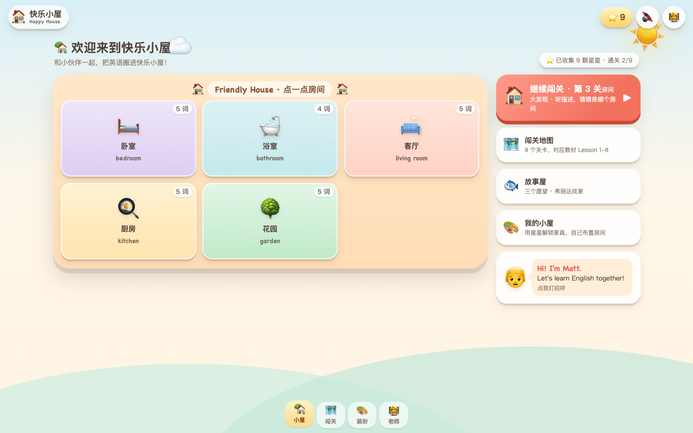
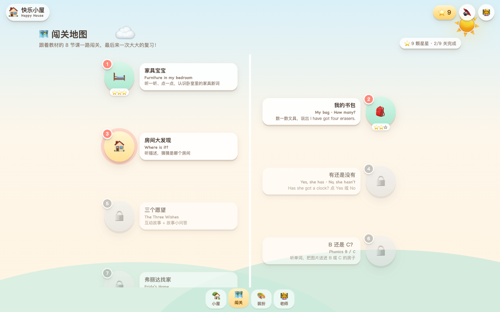
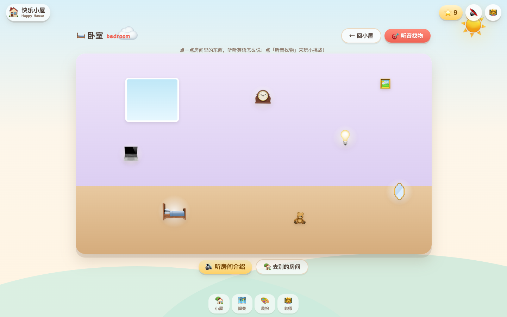
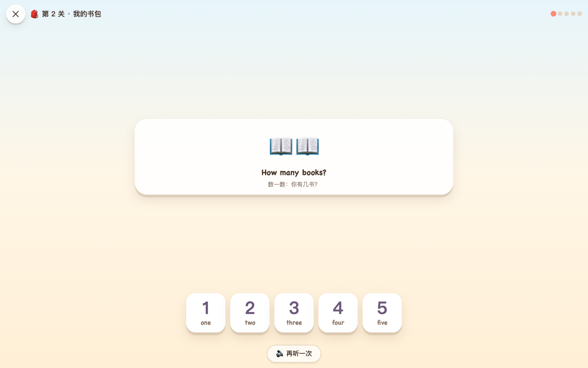
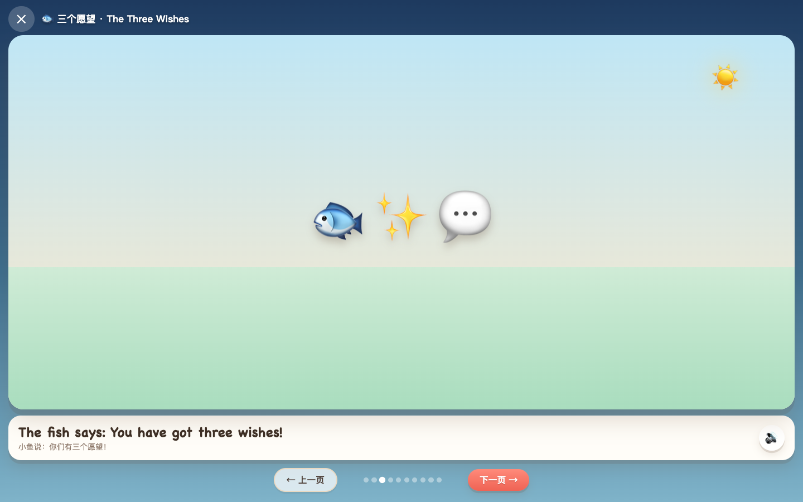
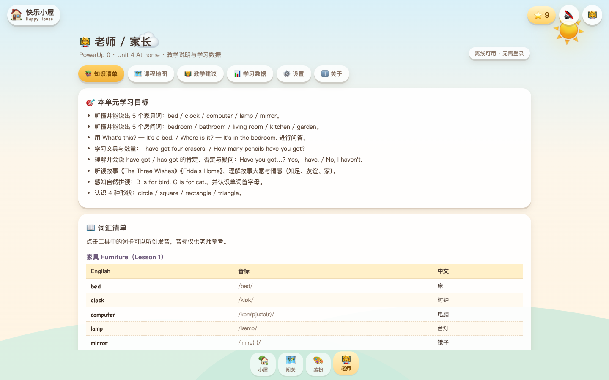
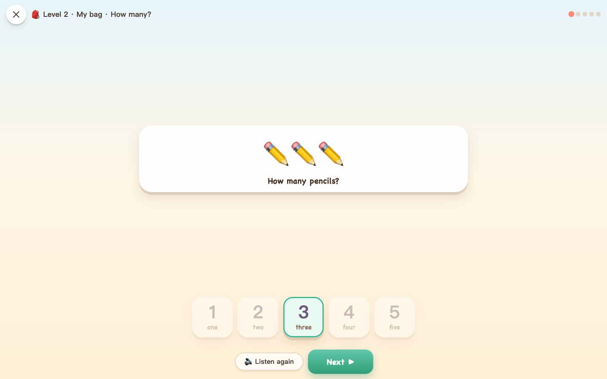
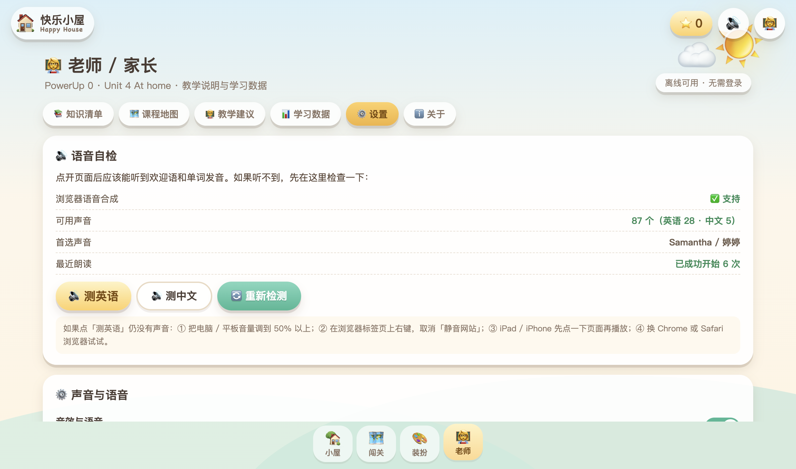

# 🏡 快乐小屋 Happy House

> 🌐 **在线体验（GitHub Pages）**：<https://chenzheng0809-gif.github.io/happy-house-powerup0/>
> 📦 **GitHub 仓库**：<https://github.com/chenzheng0809-gif/happy-house-powerup0>

> **PowerUp 0 · Unit 4 «At home» 中班-大班英语启蒙互动课件**
> 一个完全离线、双击即开的互动教学小工具：把教材里的词汇、句型、故事、自然拼读和形状，变成孩子愿意反复玩的闯关游戏。

---

## 🚀 快速开始

**方式一 · 在线玩**：直接打开 <https://chenzheng0809-gif.github.io/happy-house-powerup0/>（手机 / 平板 / 教室电脑都可以）。
**方式二 · 本地玩**：打开本文件夹，**双击 `index.html`**（推荐 Chrome / Edge / Safari）。
2. 点一下「点一点，开始探险！」——这一下同时会打开声音。
3. 上课时建议全屏：Mac `⌃⌘F`，Windows `F11`。
4. 不需要联网、不需要安装、不需要登录；所有内容都在本地。

> 如果双击后是文本编辑器打开了文件，请右键 `index.html` →「打开方式」→ 选择浏览器。

---

## 🎮 孩子能玩到什么

| 模块 | 玩法 | 对应教材 |
| --- | --- | --- |
| 🏡 快乐小屋 | 点一点 5 个房间里的家具，听英语词卡、跟读 | Lesson 1 / 3 |
| 🗺️ 闯关地图 | 9 个关卡，每关 5 题，答对得星星 | 全单元 |
| 🛏️ 第 1 关 · 家具宝宝 | 听音找物：Where is the lamp? 点一点台灯 | Lesson 1 |
| 🎒 第 2 关 · 我的书包 | 数一数文具，回答 How many…? / I have got… | Lesson 2 |
| 🏠 第 3 关 · 房间大发现 | 听描述猜房间：I have got a bed… Where is it? | Lesson 3 |
| ✅ 第 4 关 · 有还是没有 | Has she got a clock? 点 Yes / No | Lesson 4 |
| 🐟 第 5 关 · 三个愿望 | 互动故事 + 故事小问答 | Lesson 5 |
| 🔤 第 6 关 · B 还是 C？ | 听单词，判断首字母 B / C | Lesson 6 / 8 |
| 🐦 第 7 关 · 弗丽达找家 | 互动故事 + Has she got…? 问答 | Lesson 7 |
| 🔷 第 8 关 · 形状侦探 | 找圆形、正方形、长方形、三角形 | Lesson 8 |
| 🏆 第 9 关 · 复习总动员 | 词汇、句子、拼读、形状混合大挑战 | 单元复习 |
| 🎨 我的小屋 | 用星星解锁家具贴纸，拖动布置自己的房间 | 奖励机制 |
| 👩‍🏫 老师面板 | 知识清单、课程地图、教学建议、学习数据、设置 | 备课/家长 |

小游戏环节是**全英文沉浸**：题目、选项、反馈和结果页只显示英语、只朗读英语，不出现中文文字和中文语音。

答完一题后会先听到英语肯定句（如 *Yes! It is the clock.*），并出现大大的 **Next ▶** 按钮——孩子可以慢慢看画面、听完语音，自己按按钮才进入下一题（**不会自动跳题**）；最后一道题的按钮会变成 **Finish 🏁**。每道题也可以按 **🔊 Listen again** 反复听。答错会温柔提示 *Try again!* 并允许重试。

绘本探索区（「快乐小屋」点词卡）保留中英双语对照，方便家长/老师讲解；进入闯关小游戏后就是纯英语环境。

---

## 🧠 教学设计说明（为什么适合 4-6 岁）

- **多通道输入**：听（语音）、看（图/房间场景）、动（点、拖）结合，符合幼儿认知特点。
- **短回合**：每关 5 题、约 3-5 分钟，匹配中班-大班注意力时长；可反复玩。
- **句子意识**：每答对一题，都会听到完整句（如 *I have got four erasers.*），先输入后输出。
- **正向激励**：星星只增不减（重玩不扣星），三颗星有庆祝动画；奖励用于装扮小屋，形成「学习-收获-创造」闭环。
- **分层设计**：中班可只玩「听音找物」「形状侦探」；大班可挑战「有还是没有」「B 还是 C」，并鼓励说完整句。
- **课堂友好**：大屏投影、集体答题、小组轮流操作都适用；老师面板可查看各知识点正确率，及时补练。

---

## 📷 界面预览

| 快乐小屋（房间探索入口） | 闯关地图 |
| --- | --- |
|  |  |

| 卧室探索 | 数一数 · 第 2 关 |
| --- | --- |
|  |  |

| 互动故事 · 三个愿望 | 老师 / 家长面板 |
| --- | --- |
|  |  |

| 小游戏答对后出现 Next ▶ 按钮 | 语音自检（老师面板 → 设置） |
| --- | --- |
|  |  |

> 截图由 Chrome 在 1440×900 下自动生成；竖屏手机/平板布局见 `screenshots/09-portrait-map.png`。

---

## ✅ 质量验证

- 内置 50 项自动化冒烟测试（见 `tests/`），覆盖：开屏 → 小屋 → 房间词卡 → 第 1/2 关完整通关 → 其余 7 个关卡启动 → 故事流程 → 老师面板 6 个标签 → 装扮小屋 → 本地存档，**50 / 50 通过**。
- 已在 1440×900 桌面、430×860 竖屏两种视口下验证渲染。

---

## 📚 内容对标表

| 教材 | 本工具覆盖 | 核心知识点 |
| --- | --- | --- |
| Lesson 1 | 小屋 · 卧室 + 第 1 关 | bed, clock, computer, lamp, mirror；What's this? It's a bed. Where is it? |
| Lesson 2 | 第 2 关 | eraser, pencil, book, crayon, pen, bag；How many…? I have got… |
| Lesson 3 | 第 3 关 + 5 个房间 | bedroom, bathroom, living room, kitchen, garden；Have you got…? |
| Lesson 4 | 第 4 关 | have got / has got 肯定、否定、Yes/No 回答 |
| Lesson 5 | 第 5 关 · 三个愿望 | magic, wish, big house, garden, lamps/clocks/mirrors；There is/are；知足主题 |
| Lesson 6 | 第 6 关 | B/C 首字母音：book, bird, bed, bus / cat, carrot, crayon, computer, cupboard |
| Lesson 7 | 第 7 关 · 弗丽达找家 | Has Frida got…? 家与友谊主题 |
| Lesson 8 | 第 8 关 | circle, square, rectangle, triangle；单元复习 |

> 故事文本为便于 4-6 岁课堂使用做了简化改编，保留教材人物、核心词汇与情感主题；单词与句型均来自课件原文。

---

## 🗂 文件结构

```
powerup0-unit4-happy-house/
├── index.html          # 入口（双击打开）
├── css/style.css       # 全部样式（手绘感、无外部字体/图片）
├── js/data.js          # 单元内容数据（词汇/句型/房间/关卡/教师手册）
├── js/core.js          # 状态存档、语音、音效、动画、弹窗、路由
├── js/games.js         # 游戏引擎与 7 类游戏
├── js/stories.js       # 互动故事书（三个愿望 / 弗丽达找家）
├── js/pages.js         # 5 个页面：小屋/闯关/房间/装扮/老师
├── js/app.js           # 启动与全局导航
└── README.md
```

**几乎零外部依赖**：没有图片、字体、CDN；房间和教具用系统 Emoji + 手写 SVG 绘制，界面用纯 CSS 画成圆角手绘风。唯一的外部资源是内置的英语配音小音频（`audio/clips/`，约 3MB，267 条），保证任何电脑/平板都能听到标准英语发音。整个文件夹可以拷到 U 盘、教室电脑、iPad 上直接用。

---

## 🔊 声音说明

- 英文单词 / 句子 / 小游戏语音使用内置的**预录音频**（`audio/clips/`，Samantha 音色），**不依赖电脑是否安装英语语音包**，任何浏览器都能发声；中文提示仍由浏览器语音合成（Web Speech API）朗读。
- 老师面板 → 设置 →「语音自检」可查看预录配音数量，并分别测试英语/中文声音。
- **听不到声音时的自检步骤**：
  1. 先检查老师面板 →「⚙️ 设置」→「音效与语音」开关是否打开（关掉后所有声音都会静音）。
  2. 打开「🔊 语音自检」：确认「预录英语配音」显示 **267 条 ✅**（英语发音来自内置音频，**即使「可用声音 = 0 个」也能发声**），再点「🔊 测英语」「🔊 测中文」试听。
  3. 把电脑 / 平板音量调到 50% 以上，检查浏览器标签页是否被「静音网站」。
  4. iPad / iPhone 需要**先点一下页面**（点开屏按钮）再播放；建议用 Safari。
  5. Windows 电脑如果中文提示没有声音：设置 → 时间和语言 → 语言 → 添加「英语（美国）」并安装语音包；Mac：系统设置 → 辅助功能 → 朗读内容 → 系统声音 → 管理声音，下载「Samantha（英语）」和「婷婷（中文）」。
- 开屏页点按钮时就会播放欢迎语；3 秒内检测不到声音时，页面底部会出现「检查一下」提示条，点它可直接跳到语音自检。
- 右上角 🔊 可一键静音；老师面板「设置」里还有背景音乐开关和发音测试按钮。

---

## ❓ 常见问题

**Q：进度会丢吗？**
A：星星、关卡和装扮布置保存在本机浏览器（localStorage）。换浏览器、换电脑或清除浏览器数据会重置，可在老师面板 →「设置」里手动清除。

**Q：可以修改内容吗？**
A：可以。所有教学内容集中在 `js/data.js`，改词汇、句子、关卡名称都不用动其他文件；想加新词，在对应房间的 `words` 数组里加一项（`en/zh/e/x/y/fs`），页面和游戏会自动包含它。

**Q：能在 iPad 上用吗？**
A：可以，用浏览器打开即可，横屏体验最佳。建议在 Safari 中「添加到主屏幕」，像 App 一样全屏使用。

**Q：需要联网吗？**
A：完全不需要。断网、飞行模式都能正常运行（语音也来自本机）。

---

## 📄 使用范围

本工具为课堂教学与家庭共学而制作，内容整理自老师提供的 PowerUp 0 Unit 4 «At home» 课件（Lesson 1-8）。请勿用于商业出版或二次销售；教材相关图文版权归原出版社及权利人所有。
